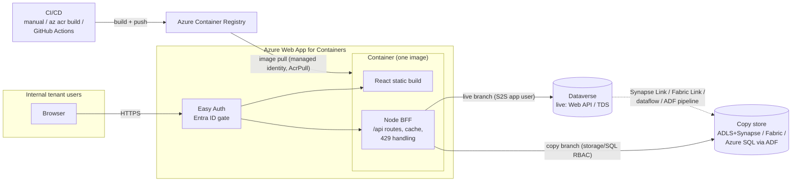

# Options Atlas — Dataverse → Azure Web App Dashboard

> Synthesized 2026-08-07 from research tickets 001–006 (linked in [Footnotes](#8-footnotes)).
> **This is a survey, not a decision.** Every layer below presents its options with tradeoffs; nothing here is a recommendation. All facts carry citations from the underlying research files, which cite primary sources (Microsoft Learn, official library docs, Azure Retail Prices API).

## 1. Executive summary

This atlas maps every viable way to build an internal, custom-interactivity dashboard over Dataverse data, inside one fixed architecture frame: a React-family frontend plus a Node BFF, packaged as a container image in Azure Container Registry, running on Azure Web App for Containers, with internal tenant users as viewers. Within that frame, each layer — data egress, auth, container, CI/CD, frontend/charting — still has real choices, and the biggest fork is **live queries vs an exported copy** (or a hybrid of both).

How to use it:

1. Match your real table schema to the closest of the four sample configurations (A–D) in [section 4](#4-the-live-vs-copy-rubric-weighted-per-configuration).
2. Run the 9-criterion live-vs-copy rubric against your actual row counts, query shapes, and staleness tolerance — the per-configuration verdicts show which criteria trip and why.
3. Pick per layer from the comparison tables in [section 3](#3-the-layers), using the build-time tags in [section 5](#5-build-time-tiers-vs-the-one-week-box) to stay inside the one-week box.
4. Hand IT the checklist in [section 6](#6-consolidated-access--prerequisites-checklist) for whatever you picked.

Cost stance throughout is corporate-sensible: floors start at ~$17/month (live-minimal) and climb to ~$300+/month only if the Fabric copy branch is chosen ([section 7](#7-cost-summary)).

## 2. The architecture at a glance

The fixed frame (all options in this atlas plug into it):

Key structural facts baked into the frame:

- App Service custom containers expose exactly **one HTTP port**, so a single multi-stage image (BFF serving `/api` + static React build) is the natural shape ([003](../wayfinder/research/003-container-path.md)).
- Easy Auth runs **in front of** the container and injects viewer identity as unspoofable `X-MS-CLIENT-PRINCIPAL*` headers — the container needs no auth code to know who is looking ([002](../wayfinder/research/002-auth-and-identity.md)).
- The browser never talks to Dataverse: the S2S credential is a confidential-client secret and all viewers share one Dataverse throttle bucket, so the BFF is the only place caching and `Retry-After` handling can live ([005](../wayfinder/research/005-frontend-and-charting.md)).
- Redeploy is pull-based: App Service does `docker pull` on restart, or automatically via an ACR webhook ([003](../wayfinder/research/003-container-path.md), [004](../wayfinder/research/004-cicd-options.md)).

## 3. The layers

### 3.1 Data egress — every way out of Dataverse

Seven paths (counting the two Synapse Link variants separately — their setup and cost profiles differ materially). Full detail and primary citations: [001-data-egress-options.md](../wayfinder/research/001-data-egress-options.md).

| # | Option | Setup time | Monthly cost | Strengths | Limits |
|---|---|---|---|---|---|
| 1 | **Dataverse Web API** (OData v4) — *live* | < 1 day | $0 incremental | Real-time; smallest setup of any path; Dataverse security model applies per query; FetchXML for hierarchy operators | 5,000 rows/page, no `$skip`; **50,000-row aggregate cap** (hard error); 6,000 req + 20 min compute + 52 concurrent per 5-min window **per user** — the BFF's one app user is a single bucket shared by all viewers; 25k (Power Apps tenants) to 500k+ (D365) requests/24h non-licensed pool |
| 2 | **TDS/SQL endpoint** — *live* | < 1 day | $0 incremental | Real T-SQL SELECT/JOIN/GROUP BY over live data from any SQL client; on by default | Read-only subset: **no CTEs, PIVOT, OVER**; 5-min query timeout (auto-cut to 2 min for expensive patterns); same service-protection throttles and 50k aggregate cap as the Web API; **no elastic tables**, no file/image columns; Entra auth only |
| 3 | **Azure Synapse Link — CSV + serverless SQL** — *copy* | 1–2 days | ~$1–20 (ADLS ~$0.02/GB-mo + serverless SQL $5/TB scanned) | Push-based, near-real-time (15–45 min typical); no aggregate caps; reads never touch Dataverse throttles; full T-SQL via serverless pool | Requires ADLS Gen2 + change tracking per table; **append-only mode requires dedupe logic** (`VersionNumber`, `isDeleted=0`) in every consumer; Dataverse security roles do **not** flow to the lake — storage RBAC is the boundary; needs Dataverse sysadmin to create |
| 4 | **Azure Synapse Link — Delta Lake + Spark** — *copy* | 2–4 days | tens to low hundreds of $ (Spark vCore-hours, scales inversely with conversion interval) | Compressed Parquet (⅓–⅛ size), faster queries, chooseable interval (5/15/60/1440 min); no dedupe burden (Delta handles it) | Spark pool provisioning + tuning time; cost floor rises with short intervals; same change-tracking and RBAC caveats as #3 |
| 5 | **Fabric Link** — *copy* | Hours **if capacity already exists**; capacity procurement is the long pole otherwise | **~$263+** (F2 pay-as-you-go 24×7, $0.18/CU-hr) **+ Dataverse storage draw** for the replica | No-ETL: wizard auto-creates Lakehouse + SQL endpoint + semantic model; no storage account to run; full Fabric surface (T-SQL, Spark, KQL, Direct Lake) | Highest fixed cost floor (billed whether or not queries run, unless paused); replica **consumes Dataverse storage capacity**; the link identity needs Dataverse **System Administrator** (a materially bigger IT grant); 15–60 min freshness; F-SKU must be same region as the environment |
| 6 | **Power Platform dataflows** — *copy* | Hours | $0 Azure incremental (license-covered); + ~$0.02/GB-mo for own-ADLS destination | Low-code Power Query authoring; no Azure resources for Dataverse-destination flows | **≤48 refreshes/day**, 2-hour per-table cap; ~500 rows/s extraction; it's an ETL surface, not a query endpoint (internal storage unreachable by external code — BYO-ADLS needed); source reads count against Dataverse API limits; author needs a Power Apps/BI license; incremental refresh to ADLS needs Plan 2 |
| 7 | **Azure Data Factory (Dataverse connector)** — *copy* | ~1 day (+ more for watermark logic) | $5–50 at small scale ($1/1,000 activity runs + $0.25/DIU-hr) + sink cost | Copy to **any sink** — Azure SQL DB gives the app a fully-owned transactional+analytical store; FetchXML source filters; service-principal or managed-identity auth | You own schema drift, deletes, and incremental watermarks; **extraction consumes the same throttled Dataverse API** (52-concurrent batch call limit) and competes with live users during runs; freshness = your trigger cadence |

> **⚠ Dead paths — do not build on these.** All appear in stale blog posts; none should carry new work ([001 §Deprecated](../wayfinder/research/001-data-egress-options.md)):
>
> | Path | Status |
> |---|---|
> | **Data Export Service** (→ Azure SQL) | End-of-life **Nov 2022** |
> | **Export to Data Lake** (F&O add-in) | Decommissioning began **Mar 2025** |
> | **OData v2 Organization Data Service** | **Removed** — the platform now returns `OrganizationDataServiceDeprecatedError` |
> | **2011 SOAP endpoint** | Deprecated; no Node story at all |
> | **BYOD (F&O)** | No EOL date, but Microsoft steers to Synapse/Fabric Link |
> | **Synapse Link "in-place update" CSV mode** | Documented as legacy; doesn't scale — use append-only or Delta |

**Tradeoffs in prose.** The two live paths cost nothing and ship in under a day, but every viewer's request lands in one shared 6k/5-min throttle bucket and any aggregate touching ≥50,000 rows hard-errors — those two ceilings, not feature preference, are what push workloads to a copy. Among copies, Synapse Link (CSV + serverless) is the cheap, self-service-shaped default; Fabric Link trades a ~$263/month floor and a System-Administrator-grade identity grant for zero plumbing; dataflows and ADF are batch tools whose freshness is whatever schedule you run, and both draw down the same live API budget during extraction. Nothing stops mixing paths — the hybrid pattern in section 4 does exactly that.

### 3.2 Auth & identity

Full detail: [002-auth-and-identity.md](../wayfinder/research/002-auth-and-identity.md).

**Server side (BFF → Dataverse): the S2S credential ladder.** All rungs share the same base: an Entra app registration (single-tenant, **no API permissions needed for S2S**) bound to an **unlicensed Dataverse application user** carrying a custom read-only security role — plus a **column security profile** if any dashboard column is secured (secured columns return masked values otherwise). Token acquisition from Node is `@azure/msal-node` client-credentials (or `@azure/identity` for managed identity) against scope `https://<org>.crm.dynamics.com/.default`.

| Rung | Setup time | Monthly cost | Strengths | Limits |
|---|---|---|---|---|
| **Client secret** | Minutes | $0 | Fastest; the documented mainstream S2S path | Expires (1–2 yrs); value shown once; must be stored (app setting / Key Vault); rotation is on you |
| **Certificate** | Hours (issue + upload) | $0 | Higher assurance than a shared secret | Renewal on expiry; private key needs a home (Key Vault) |
| **Managed identity — direct** | Hours (needs Azure + PPAC steps) | $0 | **No secret exists at all**: the Web App's user-assigned MI's Application ID is entered directly as the Dataverse application user | Azure-only — local dev still needs a secret/cert or dev credentials; requires PPAC admin cooperation |
| **Federated identity credential (FIC) on an app registration** | Hours | $0 | Keeps a governable app registration **and** eliminates secrets (registration trusts the Web App's user-assigned MI, audience `api://AzureADTokenExchange`) | Only user-assigned MIs qualify; FIC changes take minutes to propagate (transient `AADSTS70021` — add retries) |

**Viewer side (browser → app):**

| Option | Setup time | Monthly cost | Strengths | Limits |
|---|---|---|---|---|
| **Easy Auth** (App Service built-in, Entra provider) | Minutes | $0 | Zero React/Node auth code; platform gates the whole site before requests reach the container; identity injected via unspoofable `X-MS-CLIENT-PRINCIPAL*` headers; tighten to a group via enterprise-app assignment | Coarse gate — "any tenant user" by default; authorization logic beyond that is your code's job; sign-in UX is Microsoft's, not yours |
| **In-app MSAL** (`@azure/msal-browser` + BFF JWT validation) | Days | $0 | Full control of sign-in UX; fine-grained scopes; produces the token shape OBO needs | SPA redirect URIs, exposed API scope, token validation middleware, refresh/logout handling — real setup surface for a one-week build |
| **On-behalf-of (OBO)** — per-user Dataverse calls | Days (on top of a viewer token source) | $0 | Dataverse's own row/column security applies **per viewer** (no rules re-implemented in the BFF); **each viewer gets their own 6k/5-min throttle bucket** | Needs `user_impersonation` delegated permission + admin consent; every viewer needs their own Dataverse security role; responses become viewer-specific → caching gets hard; requests draw from licensed viewers' daily entitlements; irrelevant on the copy branch (RBAC moves to the copy store) |

**Middle path worth knowing:** Easy Auth with the token store enabled already hands the container the user's access token (`X-MS-TOKEN-AAD-ACCESS-TOKEN`); if the delegated-permission chain is set up, the BFF can run OBO from that header with **no SPA-side MSAL at all** ([002 §2.3](../wayfinder/research/002-auth-and-identity.md)).

**The app-level vs per-user tension in one line:** app-level (one application user + BFF-enforced visibility) keeps caching easy and the IT ask small but shares one throttle bucket and duplicates any per-viewer rules in code; per-user OBO gets native Dataverse security and per-viewer buckets at the price of a bigger IT footprint and near-uncacheable responses.

### 3.3 Container path

Full detail: [003-container-path.md](../wayfinder/research/003-container-path.md).

| Choice | Option | Setup time | Monthly cost | Strengths | Limits |
|---|---|---|---|---|---|
| **Image shape** | Single multi-stage image (Vite build stage → Node runtime serving `/api` + static) | Hours | — | One deploy unit, one TLS endpoint, no CORS; matches App Service's one-HTTP-port rule | Frontend and BFF release together |
| | Separate images (nginx + Node) via two Web Apps or sidecars | Days | — (2nd app/plan may add cost) | Independent release cadences | CORS + two apps to manage, or sidecar config; overhead unjustified for a one-week internal app |
| **ACR tier** | Basic | Minutes | **$5.00** | 10 GiB, 2 webhooks (one is all CD needs), same Entra auth/RBAC/APIs as higher tiers — fits this app comfortably | Throughput ceiling if image count/pull volume grows |
| | Standard | Minutes | $20.00 | 100 GiB, 10 webhooks, production throughput | Only needed at growth |
| | Premium | Minutes | $50.00 | **Private endpoints** (the only tier with them), geo-replication, content trust | Pay +$45/mo over Basic solely if registry network isolation is mandated |
| **Plan tier** (Linux, East US list) | B1 (1 vCPU / 1.75 GB) | Minutes | **$12.41** | Cheapest custom-container tier; now supports Always On **and** VNet integration; Microsoft's own container tutorial uses it | No deployment slots; manual scale to 3 |
| | S1 | Minutes | $69.35 | Slots, autoscale, backups | P0v3 is cheaper *and* has more RAM — S1 rarely wins |
| | P0v3 (1 vCPU / 4 GB) | Minutes | **$56.58** | Premium hardware, slots, autoscale — the defensible "production" line item (P0v4 slightly cheaper at $53.29 where available) | ~4.5× B1's price |
| | P1v3 (2 vCPU / 8 GB) | Minutes | $113.15 | Growth path | Oversized for internal viewers on day one |
| **Pull auth** | Managed identity + **AcrPull** (`acrUseManagedIdentityCreds=true`) | < 1 hour | $0 | No credentials stored anywhere; the corporate default; built-in Azure Policies exist specifically to deny the alternative | Registry must accept ARM-audience tokens or pulls fail `UNAUTHORIZED`; verify the role assignment wasn't policy-blocked |
| | ACR admin account | Minutes | $0 | Only legitimate niche: portal-driven deploy flows to ACI/ACA | Single shared username/password, full push+pull, no RBAC, disabled by default, explicitly not recommended — expect tenant policy to forbid it |

**Prose.** The minimal sensible combo is **ACR Basic + B1 ≈ $17.41/mo**; the production posture is **ACR Basic + P0v3 ≈ $61.58/mo** (slots, 4 GB). `az acr build` builds in Azure with no local Docker at all (cents per build) — relevant on locked-down Windows machines. Two operational details bite later if skipped now: set `WEBSITES_PORT` unless the container listens on 80/8080, and decide the tag strategy — `:latest` + ACR webhook gives auto-redeploy, immutable tags + explicit config update gives auditable releases. Azure Container Apps can run the identical image with scale-to-zero (~$0–5/mo idle-heavy) if per-use cost ever dominates, at the price of cold starts and a different ops model.

### 3.4 CI/CD — the effort ladder

Full detail: [004-cicd-options.md](../wayfinder/research/004-cicd-options.md). The rungs are additive, not exclusive — starting manual and layering later is legitimate.

| Rung | Setup time | Monthly cost | Per-deploy effort | New secrets | Strengths | Limits |
|---|---|---|---|---|---|---|
| **1. Manual** — `docker build`/push, restart the app | ~0 | $0 | 5–10 min human | None | Nothing to configure; fine while iterating on infrastructure | No audit trail; the app does **not** pull on its own — restart required each time |
| **2. `az acr build` + ACR webhook CD** | ~0.5–1 h | ~cents (ACR Tasks $0.0001/s; a 5-min build ≈ $0.03) | One command | None (webhook rides publishing creds) | Best effort-to-payoff ratio; no local Docker; push-to-registry auto-restarts the app | Triggered by *image* push, not *git* push — no tests/lint gate; **breaks if tenant policy disables App Service basic auth** (webhook 401s) |
| **3a. GitHub Actions — publish profile** | ~1–2 h | $0 (public repo; private: 2,000 free min/mo then $0.006/min) | `git push` | 1 GitHub secret (full publish-profile XML) | Fastest real CI (tests + build + deploy on push) | Requires SCM basic auth enabled — same tenant-policy risk as rung 2; least secure posture |
| **3b. GitHub Actions — OIDC federated** | ~0.5 day | $0 (as above) | `git push` | 3 non-sensitive IDs | Microsoft's recommended method; no long-lived secret; the standard end-state | Needs an Entra app registration + federated credential **or** a user-assigned managed identity (the UAMI route sidesteps app-registration policy); subject claim must match the workflow trigger exactly — mismatches fail silently |
| **4. Azure DevOps Pipelines** | ~1 day | $0 (free grant: 1 parallel job, 1,800 min/mo — only after linking a billing subscription) | `git push` | ARM service connection + GitHub link | `AzureWebApp` task works even with basic auth disabled; ADO environments/gates if compliance demands them | Repo is on GitHub — ADO means a second system for zero functional gain; public-project free tier is retired; PAT creation may be policy-restricted |

**Work-tenant blockers that cut across rungs** (expanded in [section 6](#6-consolidated-access--prerequisites-checklist)): app-registration creation disabled (blocks 3b's registration route — the UAMI route avoids it), Conditional Access on workload identities (can block SP sign-ins from GitHub's fixed-IP-less runners; managed identities are exempt), basic-auth-disabled policy (kills rung 2's webhook and 3a entirely), ACR admin account disabled (forces the managed-identity path, which is the documented default anyway).

### 3.5 Frontend & charting

Full detail: [005-frontend-and-charting.md](../wayfinder/research/005-frontend-and-charting.md). Shapes to serve: aggregated time-series, hierarchies (org chart / BOM → treemap, sunburst, tree), and standard KPI/bar/line, with cross-filtering as the custom-UX requirement.

**Chart libraries** (bundle = min+gzip full package; all free except where noted):

| Library | Setup/learning | License cost | Strengths | Limits |
|---|---|---|---|---|
| **Apache ECharts** (echarts-for-react) | Medium — options object, not JSX; excellent examples | $0 (Apache-2.0) | **Only library covering every project shape natively** (line/bar, treemap, sunburst, **tree**, sankey); canvas claims millions of points; cross-filtering machinery built in (`on()`, `dispatchAction`, `connect`) | Biggest bundle (~368 kB full; tree-shakable via `echarts/core`); wrapper is community-maintained, not first-party |
| **Recharts** | Low — plain JSX composition | $0 (MIT) | Fastest to learn; v3 ships treemap, sunburst, sankey natively; best KPI/bar/line DX | **No tree series** (org chart/BOM diagram missing); SVG strains at high point counts; cross-filtering is hand-rolled React state; ~148 kB |
| **Chart.js** (react-chartjs-2) | Low-medium | $0 (MIT) | Smallest (~68 kB); fast canvas; decimation plugin for dense series | Hierarchies: third-party treemap plugin only — no sunburst, no tree; no built-in cross-chart sync |
| **visx** | **High** — a primitives kit, not a chart library | $0 (MIT) | Highest custom-interaction ceiling — nothing is prebuilt, so nothing is impossible; `@visx/hierarchy` has treemap **and** tree; modular bundles | Slowest path to first pixel; sunburst hand-rolled; SVG again; riskiest fit for a one-week window |
| **AG Charts Community** | Low-medium | $0 Community / **$499/dev Enterprise** | Solid bar/line/area/pie basics; very active | **Effectively disqualified for this project's shapes**: treemap, sunburst, org chart, zoom, and chart synchronization are all Enterprise-only; largest bundle (~388 kB) for the fewest free types |

**Framework + stack combos** (no pick made):

| Combo | Setup time | Monthly cost | Strengths | Limits |
|---|---|---|---|---|
| **A — Vite + Express + ECharts** | Fits week-1 comfortably | $0 licenses | The interactivity-ceiling play: every shape native, canvas headroom for drill-downs, cross-filtering in the box; Express gives the cache/429 layer full freedom | Options-object API is the least React-ish; mitigate bundle with modular imports |
| **B — Vite + Express + Recharts** | Fastest of the three | $0 | The dev-speed play: lowest learning curve, JSX-composable | Tree-diagram gap — render org/BOM as an expandable list/treemap, or pull ECharts in for just that view (licenses permit mixing; doubles bundle on that page); cross-filtering is manual |
| **C — Next.js (`output: 'standalone'`) + visx (+ Chart.js for routine charts)** | Slowest; week-1 risk | $0 | The bespoke-UX play: no ceiling on novel linked visualizations; clean single-artifact Docker image | Charts are client components anyway, so SSR buys nothing here; server/client boundaries and build-time file tracing are new failure modes; visx-everything likely exceeds the week |

**The BFF is non-negotiable on the live branch** — three independent reasons: the S2S credential is confidential-client and cannot ship in browser JS; all viewers share one 6k/5-min throttle bucket, so the BFF must collapse N viewers into one cached upstream request and centrally honor `Retry-After`; and the Web API's 5,000-row paging (`@odata.nextLink` loops) should never reach the browser. On the copy branch the same BFF simply points at the copy store instead — the browser can't query Azure SQL or a lake either.

## 4. The live-vs-copy rubric, weighted per configuration

The rubric ([001](../wayfinder/research/001-data-egress-options.md)) scores nine criteria; the four synthetic configurations ([006](../wayfinder/research/006-sample-table-configurations.md)) each stress different ones. Match your real schema to the nearest configuration, then re-score with your actual numbers.

Scoring key: **L** = criterion favors live, **C** = favors copy, **–** = doesn't discriminate for this configuration.

| Criterion (from 001) | A — Reference mesh (<2k rows) | B — Transactional core (1.2M OrderLine) | C — Event stream (8M/yr, elastic) | D — Hierarchy & documents (400k BomLine) |
|---|---|---|---|---|
| Data volume per query | – (trivial) | L for filtered views; C for full scans | **C** — even paged extraction (5k/page, no `$skip`) is impractical | C for BOM-wide scans |
| Aggregation scope (50k cap) | – (far under) | **C** — global KPIs ("revenue by month, all time") hard-error; filtered per-account views stay under | **C** — 160× over the cap | **C** — BOM explosion over 400k intersect rows |
| Query complexity | – | L (point reads, `$expand` joins) | C (trend analytics) | Split: hierarchy `Under`/`Above` operators are **FetchXML/Web API live-only**; recursion (CTEs) exists only in a copy store — TDS has neither |
| Request rate (shared 6k/5-min bucket) | – (low traffic) | C if dashboards poll/fan out | **C** — hundreds of rows/min ingest; any live polling multiplies fast | – (tens of writes/day) |
| Latency tolerance | – (days of staleness fine) | C-compatible (minutes–hour tolerated) | C-compatible (15–60 min fine — exactly the Synapse/Fabric window) | C-compatible (hours) |
| Setup time (1-week box) | L (live is <1 day; copy adds days for no benefit) | – (both fit) | – (Synapse Link fits) | – |
| Monthly cost | L ($0 vs any copy floor) | – | – (copy cost justified) | – |
| Security model | – (nothing sensitive) | **L** for `Account.CreditLimit` (column security must not leak into a copy; live enforces it per query) | – | **L** for `Employee.Salary` (same reason) |
| Table prerequisites | – | – (standard tables, change tracking enableable) | **Elastic table: excluded from TDS entirely**; Synapse append-only aligns naturally | **File/image columns don't flow through Synapse Link** (metadata only) — documents are live-only regardless of branch |

### Verdicts

| Config | Verdict | The criterion that decides it |
|---|---|---|
| **A** | **Branch-indifferent** — nothing trips; live wins only on cost ($0) and setup (<1 day), copy works equally well if it exists for other reasons | None — the floor case |
| **B** | **Hybrid** | Aggregation cap trips for global KPIs (copy those); column security + filtered-view fit keep per-account reads live |
| **C** | **Copy-only for analytics** | Aggregation cap trips at 160×; elastic tables never appear in TDS; velocity swamps the shared bucket. Narrow single-device slices may stay live, but the dashboard's analytical core cannot |
| **D** | **Hybrid** | Both directions trip: hierarchy operators exist *only* live (FetchXML), recursion (BOM explosion) exists *only* in a copy, and files are live-only by mechanism |

### The hybrid pattern — a first-class outcome, not a compromise

B and D show the same shape, and it is worth naming as its own architecture:

- **Live filtered reads** (Web API/FetchXML through the S2S app user) for: point lookups, per-entity filtered lists under the caps, hierarchy `Under`/`Above` traversals, and anything under column security.
- **Copied aggregates** (Synapse serverless SQL / Fabric SQL endpoint / ADF-fed Azure SQL) for: global KPIs, trends, and any groupby that can touch ≥50k rows.
- **Files and images always live** — they don't export through Synapse Link, so document/photo fetches go through the Web API on every branch.

The single Node BFF is what makes this cheap: it already fronts both stores behind one `/api`, the frontend never knows which store answered, and each workload lands on the store whose limits it fits. The incremental cost over copy-only is near zero because the live leg's S2S setup (app registration + application user) is needed for file fetches anyway.

## 5. Build-time tiers vs the one-week box

Tags: **fits-day-1** (working same day), **fits-week-1** (lands inside the week alongside the app build), **exceeds-week-1** (risks or blows the box).

| Layer | fits-day-1 | fits-week-1 | exceeds-week-1 |
|---|---|---|---|
| **Egress** | Web API; TDS endpoint | Synapse Link CSV + serverless (1–2 days); dataflows (hours); ADF (~1 day + watermark logic); Fabric Link *if capacity exists* (hours) | Synapse Delta + Spark tuning (2–4 days crowds the app build); Fabric Link *if capacity must be procured/approved* |
| **Auth — S2S** | Client secret | Certificate; managed identity (direct or FIC) — hours of work but IT round-trips decide the calendar | — (nothing inherently; IT latency is the only risk) |
| **Auth — viewer** | Easy Auth (minutes) | Easy Auth + token store → OBO middle path | In-app MSAL + full per-user OBO (days of auth plumbing + per-viewer role assignments) |
| **Container** | Multi-stage Dockerfile; ACR Basic; B1 or P0v3 provisioning; MI + AcrPull | Sidecar/two-app split (unjustified here anyway) | — |
| **CI/CD** | Manual build/push/restart | `az acr build` + webhook (~1 h); GH Actions publish-profile (~1–2 h); GH Actions OIDC (~0.5 day) | Azure DevOps (~1 day, and unjustified — repo is on GitHub) |
| **Frontend** | Vite + Express scaffold; Recharts basics | Combo A (ECharts) and Combo B (Recharts) full builds; Next.js standalone if the team knows Next | Combo C's visx-everything bespoke path |

### Illustrative week-1 sequencings (one per branch — neither is a recommendation)

**Live-first week:**

| Day | Work |
|---|---|
| 1 | Entra app registration + client secret; Dataverse application user + custom `Dashboard Reader` role (+ column security profile if needed); first Web API query returns data |
| 2 | Vite + Express scaffold; BFF token acquisition (MSAL client-credentials), in-memory TTL cache, central 429/`Retry-After` handler, `@odata.nextLink` paging |
| 3 | Charts against real queries (filtered lists, FetchXML for any hierarchy view); cross-filter wiring |
| 4 | Multi-stage Dockerfile; ACR Basic; Web App on B1; MI + AcrPull pull auth; `WEBSITES_PORT`; Easy Auth on |
| 5 | CI rung of choice (`az acr build` + webhook, or GH Actions); verify aggregate scopes stay under 50k; load-sanity the shared throttle bucket; polish |

**Copy-first week (Synapse variant):**

| Day | Work |
|---|---|
| 1 | Enable Track changes on target tables; provision ADLS Gen2 (hierarchical namespace); create Synapse Link profile (initial sync runs in background); Entra app registration — needed for storage/SQL reads *and* the live file-fetch leg |
| 2 | Serverless SQL views over the lake incl. append-only dedupe (`VersionNumber`, `isDeleted=0`); grant Storage Blob Data Reader to the app identity |
| 3 | Vite + Express scaffold; BFF queries the serverless SQL endpoint (Entra token over TDS); cache layer (still worthwhile — $5/TB scanned) |
| 4 | Charts + cross-filtering over the copied aggregates; live Web API leg for any files/hierarchy views |
| 5 | Container + ACR + Web App + Easy Auth + CI rung, as in live-first day 4–5 compressed — feasible because the egress work front-loaded days 1–2 |

The visible difference: copy-first spends days 1–2 on data plumbing and compresses app-infrastructure work into day 5; live-first ships pixels by day 3 but must verify throttle/cap headroom at the end. Which risk profile is acceptable is a per-project call this atlas does not make.

## 6. Consolidated access & prerequisites checklist

### 6.1 IT request package (copy-pasteable — from [002](../wayfinder/research/002-auth-and-identity.md))

> Purpose: allow an internal read-only dashboard (Azure Web App for Containers, Node backend) to read Dataverse data server-to-server, and allow tenant users to sign in to it. No Dataverse licenses are consumed by the service account. All items are in-tenant; nothing is exposed externally.

**A. Entra ID app registration** (Azure portal → Microsoft Entra ID → App registrations)
- [ ] New registration — Name: `dataverse-dashboard-bff` (or per naming convention)
- [ ] Supported account types: **Accounts in this organizational directory only** (single tenant)
- [ ] Redirect URI: none (daemon app)
- [ ] API permissions: **none required** for server-to-server. (Only if per-user on-behalf-of access is chosen later: add **Dynamics CRM → Delegated → user_impersonation** and click **Grant admin consent**.)
- [ ] Credential — ONE of:
  - Client secret (Certificates & secrets → New client secret; 12–24 mo expiry; send us the **secret value** securely, it is shown once), or
  - Certificate (we supply the public key .cer/.pem), or
  - **Preferred — no secret:** Certificates & secrets → **Federated credentials → Add credential → scenario "Managed Identity"** → select our Web App's **user-assigned managed identity** (we will supply its name/object ID); audience `api://AzureADTokenExchange`
- [ ] Send us: **Application (client) ID** and **Directory (tenant) ID**
- *(Alternative that skips the app registration entirely: use our user-assigned managed identity's **Application ID** directly in step B.)*

**B. Dataverse application user** (Power Platform admin center → environment `<ENV NAME>` → Settings → Users + permissions → Application users)
- [ ] **+ New app user** → **+ Add an app** → select the registration from A (or paste the managed identity's **Application ID**)
- [ ] Business unit: root (default) unless advised otherwise
- [ ] Assign security role from C
- Note: this application user is **unlicensed** — it consumes no license.

**C. Custom security role** (same environment → Settings → Users + permissions → Security roles)
- [ ] Create role `Dashboard Reader` (copy of **App Opener** is a fine starting point, which includes the required minimum privileges)
- [ ] Grant **Read** (organization scope) on tables: `<LIST DASHBOARD TABLES>` — read-only; no create/write/delete needed
- [ ] Assign the role to the application user from B

**D. Column security profile** (only if dashboard columns are secured — e.g. CreditLimit, Salary)
- [ ] Settings → Users + permissions → **Column security profiles** → New profile `Dashboard Reader Columns`
- [ ] Add the application user from B to the profile
- [ ] Column permissions: **Read = Allowed** for the secured columns `<LIST SECURED COLUMNS>`; Update/Create = Not Allowed
- Without this, secured columns return masked/blocked values to the app even with a valid security role.

**E. Viewer sign-in** (Azure portal → the Web App → Settings → Authentication) *(can be done by us if we have Contributor on the Web App)*
- [ ] Add identity provider → **Microsoft** → create new app registration (workforce tenant) → Require authentication
- [ ] Optional tightening: on the created enterprise application, set **Assignment required** and assign the viewer group `<GROUP>`

**F. Separate, larger ask — ONLY if the "copy via Microsoft Fabric" branch is chosen (flag early, request only if needed)**
- The Fabric link's identity (workspace identity or service principal) must be onboarded as a Dataverse application user with the **System Administrator** role; enabling the link itself requires a System Administrator, and a Fabric-side shortcut credential likewise must hold system administrator permission. This is a materially bigger grant than A–E and needs its own approval conversation.

### 6.2 Azure roles & resources per layer

| Layer | Resources to create | Roles/permissions needed |
|---|---|---|
| Container | ACR (Basic+), Linux App Service plan (B1+), Web App | Contributor on the resource group; the Web App's managed identity needs **AcrPull** on the registry (and the registry must accept ARM-audience tokens) |
| Egress — Synapse Link | ADLS Gen2 storage account (hierarchical namespace, same tenant/region); optional Synapse workspace + Spark pool (Delta) | **Owner + Storage Blob Data Contributor** on the storage account + Reader on its resource group (for link creation); app identity needs **Storage Blob Data Reader** (direct reads) or Synapse serverless access; **Synapse Administrator** to query in Synapse Studio |
| Egress — Fabric Link | Fabric capacity (F SKU, same region as the environment) | Fabric tenant settings enabled (*create Fabric items*, *create workspaces*, *OneLake external access*); Power BI workspace admin; see 6.1-F for the Dataverse sysadmin identity |
| Egress — ADF | Data factory + sink (e.g. Azure SQL DB) | Service principal or user-assigned MI on the linked service, registered as a Dataverse application user |
| CI/CD — GH Actions OIDC | App registration + federated credential, **or** user-assigned managed identity + federated credential | Role assignment on the Web App (e.g. Website Contributor) + **AcrPush** on the registry; UAMI route needs only subscription RBAC, not Entra directory rights |
| Viewer auth | Easy Auth app registration (portal can auto-create) | Contributor on the Web App suffices to configure |

### 6.3 Power Platform admin steps

- Create the application user, custom security role, and column security profile (6.1 B–D) — needs a Power Platform admin.
- **Synapse/Fabric copy branches:** enable **Track changes** on every exported table; link creation requires the Dataverse **System Administrator** role; max 10 Synapse Link profiles per environment, 1,000 tables per profile.
- **TDS live branch:** confirm the **Enable TDS endpoint** environment setting (on by default); optionally scope with the "Allow user to access TDS endpoint" privilege; TCP 1433 reachable from the App Service outbound path.
- **Dataflows:** author needs a Power Apps/Power BI license; BYO-ADLS destination must be connected to the environment.

### 6.4 Local tooling

- **Azure CLI** (`az`) — everything below runs through it
- **Node.js 22** + npm (matches the `node:22-alpine` image)
- **Docker Desktop** — *optional*: `az acr build` builds in the cloud, so a local daemon is only needed for the fastest inner loop (relevant where Docker Desktop licensing is a question)
- **Git + GitHub access** — repo already on GitHub; `gh` CLI convenient for Actions setup
- Optional per branch: a SQL client (Synapse serverless / TDS endpoint testing), Power Platform admin center access in the browser

### 6.5 Work-tenant blockers to check *before* committing to a path (from [004](../wayfinder/research/004-cicd-options.md))

| Policy | What it blocks | Sidestep |
|---|---|---|
| "Users can register applications" = No | Self-service app registration + federated credential (S2S secret path, GH-Actions-OIDC registration route) | Application Administrator does it (use package 6.1); or the **user-assigned managed identity** route — pure Azure RBAC, no directory operation |
| Conditional Access on workload identities (Workload ID Premium) | SP sign-ins from GitHub-hosted runners (no fixed IPs) — both OIDC and secret auth, at token request | Managed identities are exempt from these policies |
| Basic auth disabled on App Service | Publish-profile deploys **and** the ACR CD webhook (401) | GH Actions OIDC/SP, or the ADO `AzureWebApp` task |
| ACR admin account disabled | Username/password registry secrets in CI | Managed-identity/Entra auth for pull and push — the documented default anyway |
| ADO org policies (PAT restrictions, parallelism grant needs billing linkage) | Azure DevOps pipeline path | Stay on GitHub Actions (repo is on GitHub regardless) |
| App registration creation possible only via IT | Calendar risk on every S2S rung | Submit package 6.1 on day 1; the credential rung (secret vs FIC) can be upgraded later without rework |
| **Fabric sysadmin ask** (6.1-F) | The entire Fabric Link branch until granted | Flag early as its own approval; Synapse Link needs only storage-account rights + Dataverse sysadmin for link creation |

## 7. Cost summary

Monthly list prices, East US, from the per-layer figures ([001](../wayfinder/research/001-data-egress-options.md), [003](../wayfinder/research/003-container-path.md), [004](../wayfinder/research/004-cicd-options.md)). Every variant includes the container base (ACR Basic $5 + plan) and effectively-$0 CI/CD (ACR Tasks bill cents; GH Actions free tier covers ~300 six-minute runs/month on a private repo).

| Architecture variant | Egress | Container base | CI/CD | **Total $/month** |
|---|---|---|---|---|
| **Live-minimal** (Web API/TDS + B1) | $0 | $17.41 (ACR Basic + B1) | ~$0 | **≈ $17** |
| **Live-production** (Web API/TDS + P0v3) | $0 | $61.58 (ACR Basic + P0v3) | ~$0 | **≈ $62** |
| **Copy-Synapse** (CSV + serverless SQL) | ~$1–20 (ADLS ~$0.02/GB-mo + $5/TB scanned); Delta/Spark variant: tens–low hundreds | $17.41–61.58 | ~$0 | **≈ $20–80** (CSV); **≈ $50–200+** (Delta) |
| **Copy-Fabric** (F2 pay-as-you-go 24×7) | ~$263 + Dataverse storage draw for the replica | $17.41–61.58 | ~$0 | **≈ $280–330+** (pausable capacity lowers it; reservations cheaper) |
| **Hybrid** (live filtered reads + Synapse aggregates + live files) | ~$1–20 (live leg adds $0) | $17.41–61.58 | ~$0 | **≈ $20–80** |

Sub-variant notes: an ADF-fed Azure SQL copy runs $5–50/mo for the pipeline **plus** the SQL database (sink cost not in scope of the research files); Azure Container Apps instead of App Service turns the plan fee into ~$0–5/mo for idle-heavy internal use, at the cost of cold starts. ACR Premium adds +$45/mo only if registry private endpoints are mandated. Dataverse request-capacity add-ons enter only if the live branch chronically exhausts the tenant's 24h pool.

Negative consequences worth keeping visible next to any budget line: the live variants' $0 egress is bounded by the shared 6k/5-min bucket and the 50k aggregate cap (exceeding them isn't a cost, it's an outage); Fabric's floor bills whether or not anyone runs a query; Synapse serverless bills per TB scanned, so an uncached dashboard hammering wide views has a variable tail.

## 8. Footnotes

**Power BI** was ruled out at framing time by the custom-UX requirement — the dashboard's bespoke cross-filtering interactions are outside what its canned visual surface provides — and appears nowhere else in this atlas.

Source research files (each carries its primary Microsoft Learn / vendor-doc / pricing-API citations):

1. [001 — Data egress options](../wayfinder/research/001-data-egress-options.md) — the seven paths, throttle/cap numbers, the 9-criterion rubric, dead paths
2. [002 — Auth & identity](../wayfinder/research/002-auth-and-identity.md) — S2S ladder, Easy Auth/MSAL/OBO, the IT request package
3. [003 — Container path](../wayfinder/research/003-container-path.md) — Dockerfile shape, ACR tiers, plan tiers, pull auth, combo costs
4. [004 — CI/CD options](../wayfinder/research/004-cicd-options.md) — the effort ladder, auth choices, work-tenant blockers
5. [005 — Frontend & charting](../wayfinder/research/005-frontend-and-charting.md) — chart library field, BFF rationale, stack combos
6. [006 — Sample table configurations](../wayfinder/research/006-sample-table-configurations.md) — configurations A–D, column-type coverage, rubric inputs
