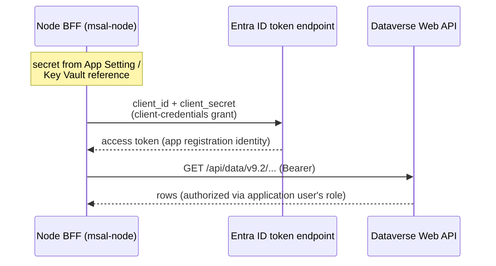
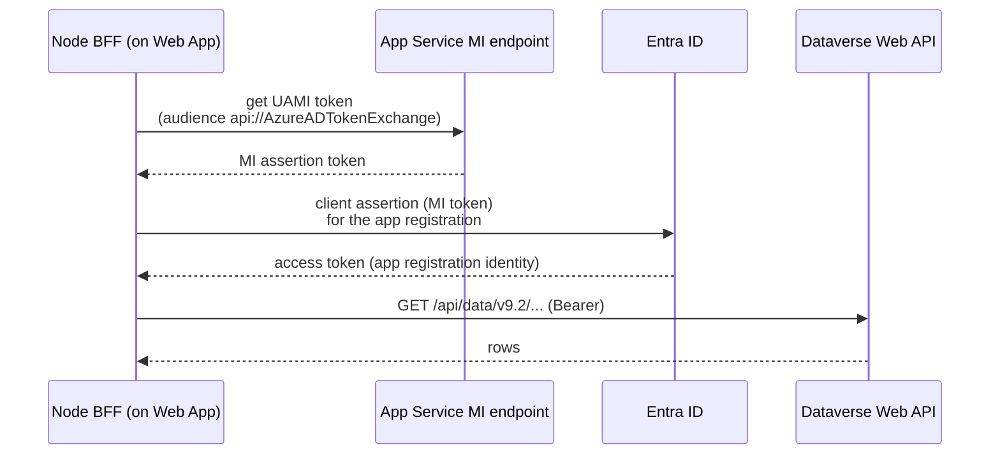
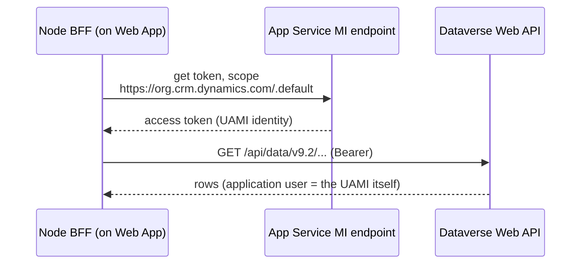

# S2S Credential Variations — BFF → Dataverse

Companion to [options-atlas.md §3.2](options-atlas.md); expands the three credential
rungs into full architecture variations. Source facts:
[002-auth-and-identity.md](../wayfinder/research/002-auth-and-identity.md).

**Shared foundation (identical in all three):** a Dataverse **application user**
(unlicensed) carrying a custom read-only `Dashboard Reader` security role, and a Node
BFF requesting tokens for scope `https://<org>.crm.dynamics.com/.default`. What varies
is *which identity object* the application user is bound to and *how the token is
obtained*. The BFF isolates that in one module — swapping variations later is a config
change plus ~10 lines, never a rebuild.

---

## Variation 1 — Client secret

The documented mainstream path. An app registration holds a secret; the BFF trades it
for tokens.

| Aspect | Detail |
|---|---|
| Entra objects | App registration (single-tenant, **no API permissions**) + client secret (12–24 mo) |
| Dataverse binding | Application user bound to the app registration's client ID |
| Node code | `@azure/msal-node` `ConfidentialClientApplication.acquireTokenByClientCredential` |
| Secret storage | Web App application setting, or Key Vault reference (no code change) |
| Local dev | **Identical to prod** — same secret in `.env` (or a separate dev registration) |
| Critical path | **None** — works before any Azure resource exists; first Dataverse query can run day 1 from a laptop |
| Ops burden | Rotation on expiry (value shown once at creation); leakage is the risk Key Vault mitigates |
| IT ask | Package item A (secret variant) + B + C — the smallest possible ask |

**Setup order:** app registration → secret → application user → role → query. No
dependency on the Web App existing.

---

## Variation 2 — Federated identity credential (FIC)

The app registration stays (governable, permission-holding), but **no secret exists**:
the registration *trusts* the Web App's user-assigned managed identity (UAMI) via a
federated credential with audience `api://AzureADTokenExchange`.

| Aspect | Detail |
|---|---|
| Entra objects | App registration (as V1, zero secrets) + **federated credential** pointing at the UAMI; the UAMI itself (Azure resource) |
| Dataverse binding | Same application user as V1 — bound to the app registration; **unchanged when upgrading from V1** |
| Node code | `@azure/identity` `ManagedIdentityCredential` for the assertion + msal-node `clientAssertion` callback |
| Secret storage | **None in prod** |
| Local dev | MI doesn't exist locally → dev uses a secret on a dev registration, or `DefaultAzureCredential` chaining (`az login` developer identity needs its own application user) |
| Critical path | UAMI must be provisioned **before** the FIC can be created → Dataverse connectivity waits for Azure infra day |
| Ops burden | Nothing expires. One transient: FIC changes propagate in minutes — handle `AADSTS70021` with retry |
| IT ask | Package A (FIC variant — needs the UAMI's identifiers) + B + C |

**Setup order:** UAMI → app registration + FIC → application user → role → deploy →
query. **Upgrade path from V1 is config-only**: add the FIC, switch the token module,
delete the secret. The application user never changes.

---

## Variation 3 — Managed identity direct

No app registration at all. The UAMI's **Application ID** is entered directly as the
Dataverse application user in Power Platform admin center.

| Aspect | Detail |
|---|---|
| Entra objects | **UAMI only** — no registration, no credential objects of any kind |
| Dataverse binding | Application user bound to the **UAMI's Application ID** |
| Node code | `@azure/identity` `ManagedIdentityCredential.getToken` — the shortest of the three |
| Secret storage | None anywhere |
| Local dev | **The weak spot**: no MI on a laptop → a *second* identity (dev registration + secret) with its **own separate application user** → two identities to keep role-synced for the app's lifetime |
| Critical path | Same as V2 — UAMI first |
| Ops burden | Zero rotation; but no app-registration object means nowhere to hang future needs (delegated permissions, OBO, additional FICs) — a dead end if per-user auth ever returns |
| IT ask | Package B (paste Application ID) + C only — **no Entra directory operation at all**, the smallest governance footprint |

**Setup order:** UAMI → application user (paste App ID) → role → deploy → query.

---

## Side-by-side

| | V1 secret | V2 FIC | V3 MI direct |
|---|---|---|---|
| Secrets in prod | 1 (rotating) | 0 | 0 |
| Entra directory objects | registration + secret | registration + FIC | none |
| Works before Azure infra exists | **yes** | no | no |
| Local dev story | same as prod | secondary credential | secondary identity + second app user |
| Rotation burden | 12–24 mo | none | none |
| Future OBO/delegated ready | yes | yes | **no** |
| IT directory ask | registration + secret | registration + FIC | none |
| Swap-away cost | config + token module | config + token module | config + token module + new app user binding |

## The staged path (how the three compose)

Because the application user binding survives V1→V2 unchanged, the standard corporate
journey is **start V1, finish V2**: day-1 connectivity from a laptop with a secret,
then — once the Web App and UAMI exist — add the FIC, flip the token module, delete
the secret. V3 is not a stage on that path (different binding); it's a minimalist
endpoint chosen when app registrations are politically expensive and per-user auth is
confidently never coming.
